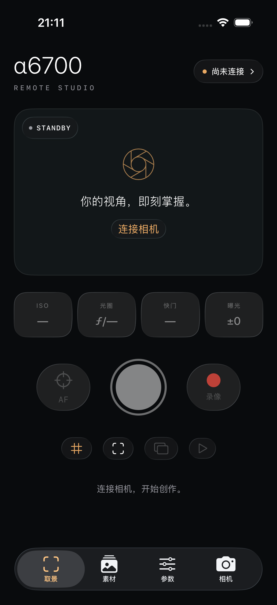

# α Remote · Sony α6700 iOS

原生 iPhone / iPad 相机遥控 App。SwiftUI 使用 iOS 26 Liquid Glass；SSH、PTP/IP 与 Sony 扩展协议直接运行在手机进程内，连接时不依赖 Mac 中转。

通过免费 Apple Account 的 Personal Team 安装。描述文件自签发起 **7 天有效**，到期后用同一团队和 Bundle ID 覆盖安装。Apple 的限制与流程见[开发者账户说明](https://developer.apple.com/help/account/basics/about-your-developer-account)。



## 当前交付

App 已构建、签名、安装并启动于 iPhone 13 Pro Max（iOS 27.0）。当前版本为 0.1.0，使用 iOS 26.4 SDK，最低支持 iOS 26。

| 手机实测 | 结果 |
|---|---|
| SSH 认证、指纹验证和 PTP 会话 | 成功连接 ILCE-6700，固件 2.00 |
| 属性读取 | 350 项，附当前值、可写状态与可选范围 |
| 实时取景 | JPEG 已在手机解码显示；测试时画面为黑色，未验收不同场景画质与长时稳定性 |
| 媒体分页 | 读取 10,919 组影像，包含跨页读取 |
| RAW 原文件导入 | 28,438,528 字节；手机文件取回 Mac 后，大小和 SHA256 与 App 记录一致 |
| ISO 写入与读回 | 250 → 200 → 250，原值已恢复 |
| 前后台恢复 | 切到主屏幕再返回，自动重连并恢复取景 |
| 覆盖安装 | 认证信息及已导入 RAW 保留 |
| 模拟器 UI | 断连快门禁用、连接表单和四页导航测试通过 |

这里的“全部参数”指相机通过当前协议返回的参数。**没有宣称覆盖机身菜单的每一项功能。** 相机声明的控制代码中，只有已经明确数据类型和行为的控制项开放操作。完整边界见 [功能与验证表](docs/CAPABILITIES.md)，持续记录见 [开发进度](docs/PROGRESS.md)。

## 功能

- 取景：JPEG 实时画面、构图网格、对焦框、电子水平仪、点击对焦区域和触控追踪。
- 拍摄：自动对焦、快门、录像切换、拍摄回传、机身按键和拨轮。
- 参数：按机身返回的能力生成全部属性列表，支持搜索、枚举、范围、字符串和数组；写前校验，写后读回。
- 素材：分页读取、缩略图、按文件名或日期搜索、照片 / RAW / 视频原文件导入、暂停续传、分享和保存到系统照片。
- 管理：OSD 叠层、相机设置备份与恢复、时间同步、LUT 上传、设备描述、显示文本和事件查看。
- 恢复：进入后台断开连接，回到前台尝试重建会话；进行中的导入核对文件身份后继续。快门和录像请求不自动重发。

录像、删除、恢复设置、LUT 上传、大视频和部分控制项已有接口与 UI，尚未逐项完成本机实测。蓝牙唤醒、自动加入相机热点和后台持续导入尚未实现。

## 构建与安装

需要完整 Xcode 26 或更新版本、Go，以及已登录 Xcode 的 Apple Account。Go 会按 `go.mod` 下载固定的 Go 1.26 工具链及依赖。代码不依赖 CocoaPods、XcodeGen 或远程服务。

```sh
git clone --recurse-submodules https://github.com/class-undefined/alpha6700-ios.git
cd alpha6700-ios
open ios/AlphaRemote.xcodeproj
```

在 Xcode 中选择 `AlphaRemote` target，在 Signing & Capabilities 选择自己的 Personal Team。连接 iPhone，启用开发者模式，选择手机并运行。

也可以在被 Git 忽略的 `ios/Local.xcconfig` 中配置：

```xcconfig
DEVELOPMENT_TEAM = YOUR_TEAM_ID
// 如标识已被占用，可改为自己唯一的标识。
PRODUCT_BUNDLE_IDENTIFIER = com.yourname.alpha6700
```

然后执行以下命令。只有一台配对的 iOS 设备时可省略设备标识：

```sh
scripts/install-device.sh
# 或 scripts/install-device.sh DEVICE_IDENTIFIER
```

脚本自动构建协议静态库、签名、覆盖安装、启动 App，并打印实际签名到期时间。续签运行同一命令，保留同一 Team 和 Bundle ID。Xcode 可能复用尚未到期的描述文件，不能把一次提前重装当成已经延长了 7 天，以脚本打印的日期为准。详细步骤与排错见 [安装说明](docs/INSTALL.md)。

## 连接相机

1. 让 iPhone 与相机加入同一局域网，开启相机的电脑遥控。退出其他 App 的远程拍摄或导入会话。
2. 在机身查看“网络 → 网络选项 → 访问认证信息”，填入 IP、用户名、访问认证密码和 SHA256 指纹。
3. 在 iPhone 允许局域网访问，然后连接。首次权限弹窗可能令当前请求失败，授权后再点一次连接。

认证信息只保存在 iOS Keychain。访问认证密码与 Wi-Fi 密码不同。App 会先验证相机指纹，再发送密码。[Sony 认证说明](https://helpguide.sony.net/ilc/2320/v1/en/contents/221h_access_authentication_information.html)

免费签名版本通过单播查找相机，也支持手填 IP。SSDP 多播需要 Apple 授权的 entitlement，本版本不依赖它。[Apple 多播权限说明](https://developer.apple.com/documentation/bundleresources/entitlements/com.apple.developer.networking.multicast)

## 验证与项目结构

```sh
scripts/check.sh
xcodebuild -project ios/AlphaRemote.xcodeproj -scheme AlphaRemote \
  -destination 'platform=iOS Simulator,name=iPhone 17 Pro' \
  -derivedDataPath build/DerivedData CODE_SIGNING_ALLOWED=NO test
```

| 路径 | 内容 |
|---|---|
| `ios/AlphaRemote/` | SwiftUI、Keychain、照片导入、原生 C 桥接 |
| `mobile/core/` | 协议会话、动态属性、控制与持久化传输 |
| `mobile/bridge/` | Go 到 C ABI 导出 |
| `vendor/alpha2go/` | 固定版本的 Apache-2.0 上游子模块 |
| `prototype/` | 保留的 Mac 协议验证程序 |
| `docs/` | 安装、架构、功能矩阵和进度 |
| `evidence/` | 本机原始证据，未公开 |

[架构说明](docs/ARCHITECTURE.md) · [协议映射](PROTOCOL_MAP.md) · [早期调查记录](docs/PROTOCOL_RESEARCH.md) · [第三方来源](THIRD_PARTY.md)

本项目与 Sony 无隶属关系。许可证为 Apache-2.0；第三方许可证随源码和 App 保留。
