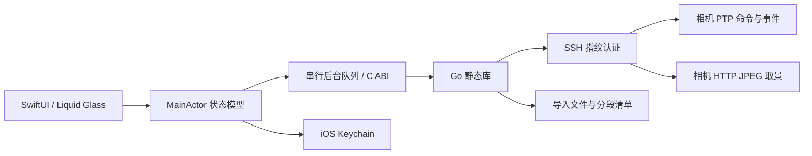

# 原生客户端架构

## 数据路径

Go 编译为 iOS `c-archive`，由 Xcode 链接到 App。它是同一进程中的原生机器码，不是 WebView、外部进程或 Mac 服务。界面、权限、生命周期、照片图库和分享全部使用 Apple 原生 API。

## 边界与并发

`CameraCreate` 创建引擎，使用持久化 GUID 标识客户端。`CameraRequest` 接受内部 JSON 请求并返回 JSON 结果。Swift 在后台串行队列执行阻塞请求，在主线程更新界面。所有 C 返回的内存经 `CameraFree` 释放。

相机命令序列由 Go 互斥锁保护。取景通过独立 SSH 通道读取，只保留最新一帧，界面约每 66 ms 取一帧。事件缓存最多 80 条。属性轮询每 2 秒一次，导入与写操作期间暂停轮询，避免积压。

`CameraAbort` 可从另一线程取消网络工作。Swift 使用会话标识忽略过期连接与导入结果。后台时主动断开；前台重连使用相同 GUID，重新握手和读取能力。快门、录像、删除、恢复和上传没有重试队列。

## 参数与控制

读取所有属性后，界面展示当前值、可写状态、枚举或范围。写操作重新读取描述；检查 `Writable`、`Enabled`、数值位宽、枚举成员和范围步长。写后短暂轮询，只有读回一致才报告完成。

64 位原始参数以字符串通过 JSON 边界，避免经过浮点数时丢失精度。字符串、数组和标量保留原始类型。快门的高低 16 位分别是分子、分母；ISO 保留感光度与模式位。特殊光圈值与无效水平角不显示成普通数值。

静态目录提供 783 项名称，优先保留 alpha2go 的已核对条目，再为其余代码补名称。目录不包含机型支持标记、写入范围或额外控制命令。控制项只使用已知类型的 8 类操作，按机身声明和当前状态检查。

## 文件与恢复

每个导入任务包含相机身份、内容 ID、文件 ID、路径、创建时间、大小和 UMID。任务键由这些字段计算。续传传入原任务键，机身当前文件不匹配时拒绝继续，避免把更换存储卡后的同编号文件拼接到旧文件。

每次最多读取 2 MiB。只有相机完整响应并确认后，才更新已提交偏移。中途失败截掉本段尾部；进程重启时也截到清单中已提交的位置。文件写入和清单分别执行同步与原子替换。

完成后计算 SHA256，并将文件暴露为最终名称。保留分段文件到完成清单提交之后，缩小崩溃时的恢复窗口。清单中的本机绝对路径会按当前 App 数据容器重新解析，支持覆盖安装后容器路径变化。

首次恢复连接会重新读取媒体列表。10,919 组影像已在现场 iPhone 跨页读取；更多内容、列表变化和相同时间戳的分页边界仍需额外验证。系统照片不支持的格式仍可通过文件分享导出。

## 凭据与公开仓库

密码存入 `kSecAttrAccessibleWhenUnlockedThisDeviceOnly` Keychain，不进入 UserDefaults。相机指纹核验发生在密码发送之前。错误输出替换凭据和相机 HTTP 地址。

原始影像、个人证据、构建产物、手机标识、签名文件与 `Local.xcconfig` 均不进入 Git。App 不发送遥测。局域网发现只扫描本机私有 IPv4 网络中的 /24 候选，再读取 Sony 元数据，不在发现阶段发送密码。

## 构建与测试

`build-core.sh` 根据 Xcode SDK 和架构生成静态库。当前现场构建验证的是 Apple Silicon Mac 的 arm64 模拟器和 arm64 真机。Intel 模拟器编译路径存在，但未实测。

核心测试覆盖参数约束、64 位数值、分段失败回滚、超过 4 GiB 的偏移、空卡请求、删除确认、导入持久化和身份变化。`go test -race` 检查并发访问。SwiftUI 测试检查断连状态、连接表单和四页导航；截图从 xcresult 导出后人工查看。

## 设计参考

原生玻璃组合参考 [Apple 自定义视图 Liquid Glass](https://developer.apple.com/documentation/swiftui/applying-liquid-glass-to-custom-views) 和 [Liquid-Glass-Examples](https://github.com/pchelnikov/Liquid-Glass-Examples)。未复制该项目界面代码。

快门编码交叉核对 [libgphoto2 的 Sony 配置实现](https://github.com/gphoto/libgphoto2/blob/master/camlibs/ptp2/config.c)，未引入其代码。光圈特殊值、ISO 模式与名称表交叉核对 [mikefsq/ptp](https://github.com/mikefsq/ptp/blob/0fe3c68516f8c0fe89c963437bbc385d68620b25/sony/exposure.go)。引入的名称数据保留 MIT 许可。
